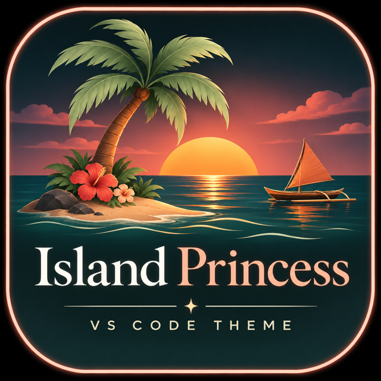

<p align="center"></p>

# Island Princess

A dark VS Code theme with a tropical island night, palm leaves, terracotta earth and a golden sunset.

## Palette

<!-- palette:start -->
| Role | Color |
| --- | --- |
| Sidebar and panels | `#0b1314` |
| Editor background | `#101a1b` |
| Menus, inputs and widgets | `#192a2b` |
| UI accent (selection, notification badges) | `#245d4d` |
| Buttons (coral) | `#ee9a80` |
| Text | `#f4f2ea` |
| Comments | `#9a8f7e` |
| Keywords and operators (palm leaf) | `#7daf8c` |
| Terracotta: control flow, JSX tags | `#e07a4f` |
| Functions, keys, attributes (sand) | `#d6d3ba` |
| Strings (sunset gold) | `#e8ad62` |
| Types, numbers, constants, highlights (coral) | `#f6b5a0` |
| Hibiscus: this, regex, enum members, active icon | `#ee4e3e` |
<!-- palette:end -->

## Install

Search for **Island Princess** in the Extensions view, or run:

```
code --install-extension thaisemanuele.island-princess
```
